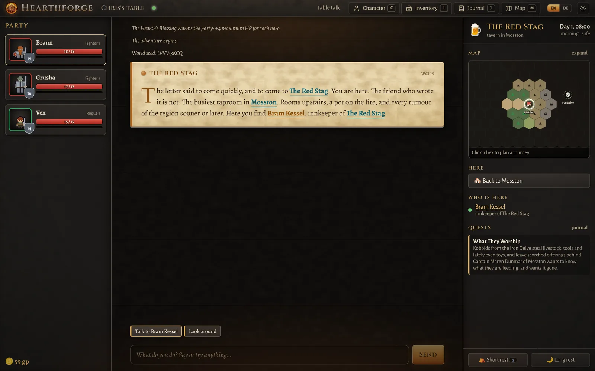
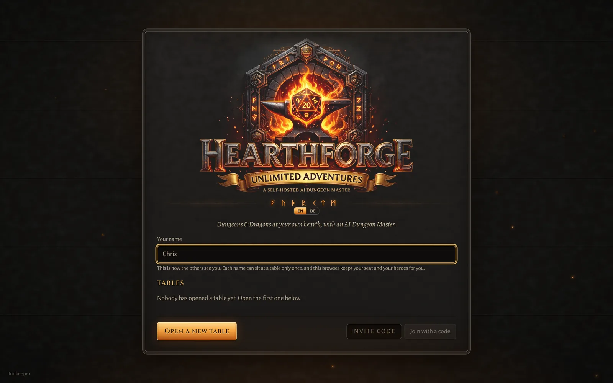
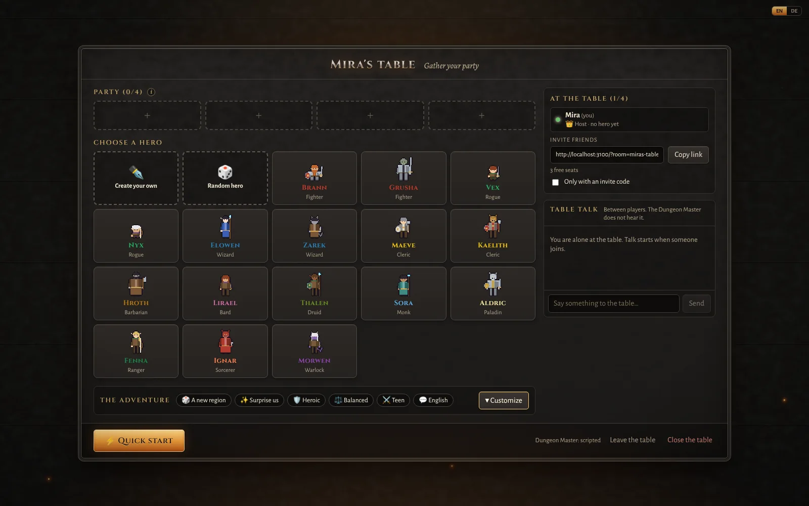
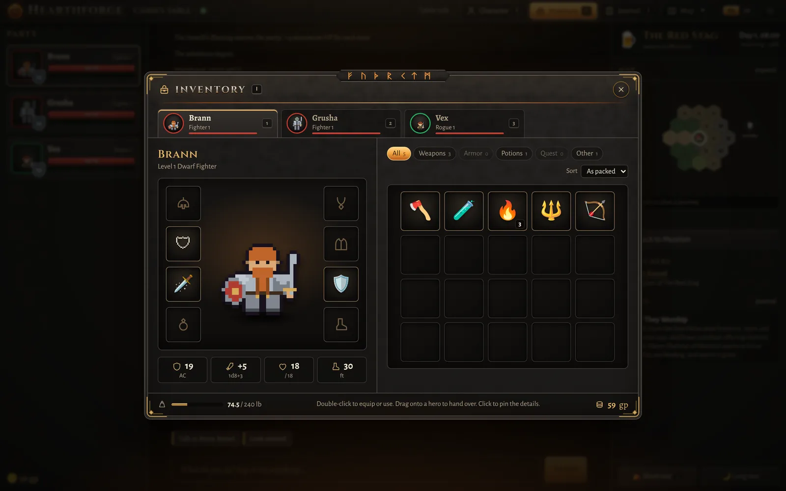
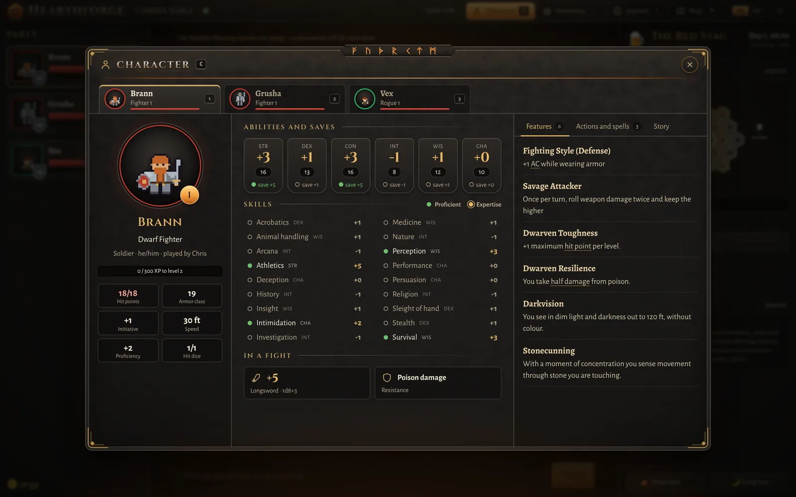
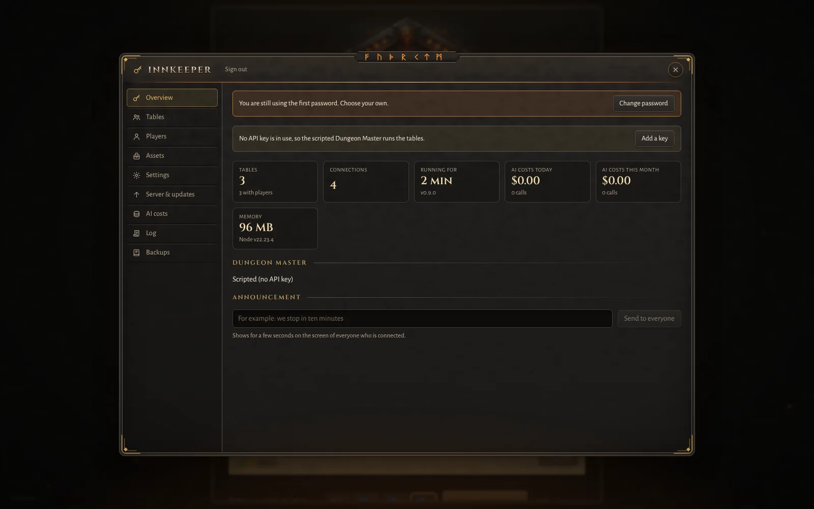

<p align="center">
  
</p>

# Hearthforge

A self-hosted Dungeons & Dragons 5e game for your browser, run by an AI Dungeon Master.

You run Hearthforge as one Docker container on your own server. You and your friends open it in a browser, build a party, and set out into an open world: a hex map to travel, a story told in scene cards, and a tactical grid that appears only when a fight breaks out. The server owns the rules and rolls every die. Claude narrates, plays everyone you meet and decides what the monsters do. Play alone with up to four heroes, or share a table with friends. There is always an AI Dungeon Master, never a human one.

<p align="center">
  
</p>

<table>
  <tr>
    <td></td>
    <td></td>
  </tr>
  <tr>
    <td align="center"><sub>Lobby</sub></td>
    <td align="center"><sub>Table room: pick the region, the opening and the seed</sub></td>
  </tr>
  <tr>
    <td></td>
    <td></td>
  </tr>
  <tr>
    <td align="center"><sub>Inventory with paper-doll</sub></td>
    <td align="center"><sub>Character sheet</sub></td>
  </tr>
  <tr>
    <td colspan="2"></td>
  </tr>
  <tr>
    <td colspan="2" align="center"><sub>The Innkeeper, the owner's panel: updates, settings, tables, backups and assets without a terminal</sub></td>
  </tr>
</table>

## Contents

[What's in the game](#whats-in-the-game) · [Install](#install-on-proxmox) · [Configuration](#configuration) · [The Innkeeper](#the-innkeeper) · [Art and music](#art-and-music) · [Playing together](#playing-together) · [Where the adventure starts](#where-the-adventure-starts) · [How to play](#how-to-play) · [Development](#development) · [Credits](#credits-and-licenses)

## What's in the game

**Story first.** Narration arrives as scene cards with a location and a mood. Each scene offers a few action buttons, and you can always type anything instead. People, places and items are highlighted, with details on hover. The world remembers: people, quests, deeds and places are saved and handed to the Dungeon Master every turn, and the journal (`j`) shows them as a book.

**An open world.** A hex overworld (6 miles per hex) that you travel freely. Pick a hex to see distance, travel time, terrain and the chance of an encounter, then set out. Explored country stays on the map and the Dungeon Master can add places as the story finds them.

**Turn-based 5e combat** on a battle map generated for the place where the fight breaks out (swamp, forest, plains, road, bridge, camp, town streets, tavern, cave, ruin, dungeon and more). Initiative, movement, attack rolls, advantage, critical hits, saving throws, Sneak Attack, cantrips and 1st-level spells, potions, death saves, difficult terrain and cover. Monsters are drawn from a body shape and layered extras, and the Dungeon Master can restyle them, but their numbers always come from a real stat block: all 341 monsters of the SRD 5.2.1, from Challenge 0 to 30, with multiattack, breath weapons and other area effects, conditions (poisoned, grappled, paralysed, frightened and more, with a Break free action), regeneration, resistances, Magic and Legendary Resistance and legendary actions. The Dungeon Master searches the catalogue by name, type and Challenge and is told how hard a fight is for the party before it starts.

**Heroes.** Sixteen premade heroes, or a guided creator with all twelve classes of the SRD 5.2.1 (Barbarian, Bard, Cleric, Druid, Fighter, Monk, Paladin, Ranger, Rogue, Sorcerer, Warlock, Wizard), nine species, four backgrounds, ability scores, skills, talents, equipment, looks and backstory. Every option explains what it does and who it suits. Portraits and battle tokens are drawn from the hero's looks and gear, so they change when the gear does. Progression runs from level 1 to 20: a subclass at level 3, feats or ability increases along the way, an epic boon at level 19, and the choices each class makes (fighting styles, expertise, metamagic, invocations). The game runs the class features itself: Rage, Wild Shape, focus points, Lay on Hands and Divine Smite, Bardic Inspiration, Channel Divinity, sorcery points, Hunter's Mark and Hex, Cunning Strike, Extra Attack and the rest, each with its own counter on the hero's card.

**Inventory and sheet.** Paper-doll slots, a backpack, shared party gold, drag and drop, and items the Dungeon Master invents in play (a letter, a strange key) with their own notes. A full character sheet on `c`.

**Merchants.** Every town has a general store, a smithy and an apothecary, every village a trader, and the Dungeon Master can open more (a curio shop, a peddler on the road). Shops keep real stock that changes every three days and a purse of their own. Buy and sell in the trade window (`t`), and haggle with a Persuasion check once a day.

**Solo or multiplayer.** A lobby lists the tables. Each table has a host, a ready check, invite links, an optional invite code and an out-of-character chat. See [Playing together](#playing-together).

**English and German.** Every player picks their own interface language. The table picks the story language, and the narration, the game log and the starting region follow it. German uses the terms of the official German edition.

**Music and sound** that follow the story (tavern, town, road, dungeon, fights, bosses), with a volume slider per player. Nothing is bundled; see [Art and music](#art-and-music).

**The look.** Dark iron and stone frames, ember and gold for everything that glows, rune bands on the windows and parchment for the story, following the logo. Fonts are bundled and the browser loads nothing from the internet.

**Games are saved** in SQLite and survive restarts and updates.

### The AI Dungeon Master

The Dungeon Master picks the Claude model by the moment: a small, fast model for background work, a mid-sized one for everyday narration and monster turns, and a stronger one for key moments such as the opening scene, a first arrival, boss fights, level-ups and turning points. The three models are configurable, or you can force one model for everything. Without an API key a scripted fallback runs travel, fights, rests and dungeons, but it cannot improvise. The Dungeon Master never changes game state itself: it proposes monster actions through tool calls, the engine resolves them with real dice, and the Dungeon Master narrates the result.

## Install on Proxmox

On the Proxmox host, as root:

```bash
bash -c "$(curl -fsSL https://raw.githubusercontent.com/DBCooperX/hearthforge/main/scripts/proxmox-install.sh)"
```

The script creates an unprivileged Debian 12 LXC named `hearthforge` (nesting and keyctl on, for Docker), installs Docker, clones this repository to `/opt/hearthforge`, asks for your Anthropic API key, writes `.env` and starts the containers. At the end it prints the address to open and the first password for the [Innkeeper](#the-innkeeper). From then on you should not need a terminal: updates, restarts, the API key and every setting live in the Innkeeper.

Run the same command again to update an older install (it adds the updater and prints a first password) or whenever you prefer the terminal.

Defaults are 2 cores, 2 GB RAM, 8 GB disk, DHCP on `vmbr0`, the next free container id and your `local-lvm` or `local-zfs` storage. Override them with variables:

```bash
CTID=120 STORAGE=tank MEMORY=4096 IP=192.168.1.50/24 GATEWAY=192.168.1.1 \
  bash -c "$(curl -fsSL https://raw.githubusercontent.com/DBCooperX/hearthforge/main/scripts/proxmox-install.sh)"
```

| Variable | Default | |
| --- | --- | --- |
| `CTID` | next free id | Container id |
| `HOSTNAME_CT` | `hearthforge` | Container name, also how a re-run finds it |
| `STORAGE` | auto | Storage for the root disk |
| `TEMPLATE_STORAGE` | `local` | Storage holding container templates |
| `BRIDGE`, `IP`, `GATEWAY` | `vmbr0`, `dhcp`, none | Networking |
| `CORES`, `MEMORY`, `SWAP`, `DISK` | `2`, `2048`, `512`, `8` | Resources (MB and GB) |
| `PORT` | `3000` | Port Hearthforge is published on |
| `ANTHROPIC_API_KEY` | prompt | Set it to skip the prompt |
| `BRANCH` | `main` | Git branch to install |

Read [`scripts/proxmox-install.sh`](scripts/proxmox-install.sh) first if you like; it is short.

### Anywhere else with Docker

Any Debian 12 or Ubuntu machine with Docker works (an LXC needs nesting and keyctl; a VM needs nothing special):

```bash
git clone https://github.com/DBCooperX/hearthforge.git /opt/hearthforge
cd /opt/hearthforge
cp .env.example .env     # add your ANTHROPIC_API_KEY, or add it later in the Innkeeper
docker compose up -d --build
```

Open `http://<address>:3000`. Friends on your network use the same address. Saved games live in the `hearthforge-data` Docker volume and are kept across updates. `docker compose logs -f` shows the server log, including whether the AI Dungeon Master is active.

### Updating

Open the Innkeeper, go to **Server & updates** and press **Update now**, or switch on automatic updates. By hand, re-run the installer or run `git pull && docker compose up -d --build` in `/opt/hearthforge`.

## Configuration

Everything below can be changed in the **Innkeeper → Settings**. A value set there wins over `.env` and applies after a restart, which the panel offers. To set them in `.env` instead:

| Variable | Default | Purpose |
| --- | --- | --- |
| `ANTHROPIC_API_KEY` | empty | Your key from [platform.claude.com](https://platform.claude.com). Empty means the scripted fallback. |
| `HEARTHFORGE_DM_MODEL_BACKGROUND` | `claude-haiku-5-5` | Background work: memory summaries, short journeys, rests. |
| `HEARTHFORGE_DM_MODEL_STANDARD` | `claude-sonnet-5-5` | Everyday narration, conversation and monster turns. |
| `HEARTHFORGE_DM_MODEL_KEY` | `claude-opus-5-5` | Key moments: opening scene, major arrivals, boss fights, level-ups, defeats, turning points. |
| `HEARTHFORGE_DM_FORCE_MODEL` | empty | A model id that replaces the automatic choice. |
| `HEARTHFORGE_DM_EFFORT` | `low` | How hard the DM thinks per beat: `low`, `medium` or `high`. |
| `HEARTHFORGE_ART` | `generated` | Tile pack for a fresh server: `generated`, `kenney` or `0x72`. A choice made in the game wins. |
| `HEARTHFORGE_ART_UPLOADS` | `on` | `off` locks the art library against changes from the browser. |
| `HEARTHFORGE_AUTO_ASSETS` | `on` | Fetch freely licensed item icons on first start. |
| `HEARTHFORGE_MUSIC` | `on` | `off` skips the music download and the player. |
| `HEARTHFORGE_TURN_WAIT` | `8` | Seconds the DM waits for the other players after the first one acts. `0` answers every action at once. |
| `HEARTHFORGE_REACTION_WAIT` | `20` | Seconds a player gets to decide on an opportunity attack when an enemy leaves their hero's reach. After that the hero strikes. `0` never asks. |
| `HEARTHFORGE_AUTO_UPDATE` | `off` | `on` installs new versions by itself when nobody sits at a table. |
| `HEARTHFORGE_TRUST_PROXY` | `off` | Read the player's address from `X-Forwarded-For`. Only behind your own reverse proxy. |
| `HEARTHFORGE_PORT` | `3000` | Port on the host (`.env` only). |
| `HEARTHFORGE_ADMIN_PASSWORD` | generated | First Innkeeper password; only read until you change it (`.env` only). |
| `HEARTHFORGE_ADMIN` | `on` | `off` removes the Innkeeper (`.env` only). |
| `HEARTHFORGE_BRANCH` | checked-out branch | Git branch the updater follows (`.env` only). |

Every model call is logged as `[dm] <purpose>: tier=<tier> model=<model>`. The DM makes roughly one API call per story beat and two per round of monster turns.

Players have no accounts. Each browser keeps a secret token that proves a seat is its own, and a table can ask for an invite code, but anyone who can reach the port can see the tables. Keep it on your LAN, behind a VPN or behind an authenticating reverse proxy. A reverse proxy must forward WebSocket upgrades for `/ws`.

## The Innkeeper

The Innkeeper is the owner's panel. Open it from the lobby, from **Settings → Server**, or at `http://<address>:3000/?innkeeper`, and sign in with the password the installer printed (or the one the server wrote to its log and to `/data/innkeeper-first-password.txt`). Change it under **Server & updates**.

| Page | What it does |
| --- | --- |
| **Overview** | What is running, who is playing, today's AI cost, and an announcement for every player. |
| **Tables** | Every table with players, region, seed and last save. Pause, resume, remove a player or delete a table. |
| **Players** | Open connections with address and browser. Disconnect someone or ban an address. |
| **Assets** | Music, ambient sounds and art packs. See [Art and music](#art-and-music). |
| **Settings** | The configuration above, including the API key (masked) with a **Test key** button. |
| **Server & updates** | Version, update, restart (now or with a warning to players) and the password. |
| **AI costs** | Calls, tokens and estimated cost per day, table and model for 90 days. An estimate from list prices, not your invoice. |
| **Log** | The live server log with a filter. |
| **Backups** | Daily backups of all tables and settings (the last 14 are kept), on demand, as a download, and restore. Art, music and the API key are not included. |

**How updating works.** A second small container, the *updater*, sits next to the game. When you press **Update now** the game leaves a request in a folder they share. The updater pulls the latest code, builds the new image while the game keeps running, and swaps the container in a few seconds. If the build fails or the new version does not come up healthy, it puts the previous one back and the panel says so. Saved games are not touched. The updater needs the Docker socket, which is as good as root in the guest. It opens no port and only understands `check` and `update`. To go without it, remove the `updater` service from `docker-compose.yml`; the panel then says updates are done in the terminal.

The Innkeeper password travels over plain HTTP unless you put TLS in front. Five wrong passwords lock an address out for five minutes. If you forget it, delete `/data/innkeeper.json` and restart; the first password applies again:

```bash
docker compose exec hearthforge rm /data/innkeeper.json && docker compose restart hearthforge
```

## Art and music

Hearthforge bundles no third-party art or audio, and it never hosts or mirrors anything. Out of the box it draws its own 16×16 pixel art and shows items as emoji. Everything else goes from the artist's site to your server, and how depends on what the source allows:

| Source type | What happens |
| --- | --- |
| **Free license** (CC0, CC BY) | The server downloads it by itself: Kevin MacLeod's 50 music tracks (CC BY 4.0) and the game-icons.net item icons (CC BY 3.0). Switch off with `HEARTHFORGE_MUSIC=off` or `HEARTHFORGE_AUTO_ASSETS=off`. |
| **Direct download allowed** | The owner presses **Download** in the Innkeeper, or pastes a direct link, and the server fetches it from the source (for example Kenney, OpenGameArt). |
| **Login, Patreon or terms that forbid it** | The Innkeeper shows a **Get it here** link; download the file yourself and drag it onto the page (itch.io, Freesound, Sonniss, Pixabay). |

In the Innkeeper's **Assets** page, with the tabs **Music**, **Ambient** and **Art**:

- **Music.** Every track can be played, switched off, moved to another scene (tavern, town, overworld, dungeon, combat, boss) or removed. Tracks that failed to download get a button to try again. Drop audio files or a zip onto the page, or paste a link. Files are kept in `/data/music`.
- **Ambient sound.** Quiet loops (crowd, fire, wind, rain) under the music with their own volume slider. Nothing is downloaded by default, so add your own.
- **Art.** Drop a zip from itch.io, Kenney or OpenGameArt. PNG images are kept, packs are recognised by name or contents, and item icons are matched by file name, with **Assign icons** for the rest. Players see what is in use, with credits, under **Settings → Art & Assets**.

Licenses differ: CC0 needs nothing, CC BY needs a credit (the game shows title, artist and license of the playing track and the art packs in use), and a few free packs may be used but not passed on. [CREDITS.md](CREDITS.md) lists what was checked. The Kenney and 0x72 tile mappings are experimental, since the packs could not be downloaded where this was built. To correct a Kenney tile, write numbers into `kenney-map.json`:

```bash
docker compose exec hearthforge sh -c 'echo "{\"goblin\": 111, \"fighter\": 96}" > /data/art/kenney-map.json'
```

Browsers only allow sound after the first click, so music starts when a player first touches the page. A scene with no track is silent, and a failed download never breaks the game.

## Playing together

- **Who you are.** Your browser keeps a secret token, and the seat and heroes you take belong to it. A name can sit at a table only once. After a reload, a dropped connection or a server restart the same browser gets its seat back.
- **Tables.** The lobby lists every table with its players, story language, free seats and whether the adventure has begun. A table has 1 to 4 seats and can ask for an invite code. The table room shows an invite link to copy.
- **Before the adventure.** Everyone picks or creates heroes and says they are ready, then the host begins. The host can remove a player, hand the table over, or close it. If the host is gone for 20 seconds, the player who has sat longest takes over.
- **Away players.** A disconnected player keeps their seat. In a fight anyone may play an away hero so the order never stalls; in the story the Dungeon Master keeps them in the background.
- **Table talk.** An out-of-character chat with whispers, which the Dungeon Master never reads. What you type into the story box is in character.
- **Whose turn.** In a fight the initiative order decides. In the story the first action opens a short window (`HEARTHFORGE_TURN_WAIT`), and the Dungeon Master answers once everyone has acted or the window closes, resolving all actions in one scene.
- **Reactions.** When an enemy leaves a hero's reach, the fight pauses for that hero's player only: strike or let it go (`HEARTHFORGE_REACTION_WAIT`). Each hero can be set to ask, always strike or never; a player who is away never holds up the table.

## Where the adventure starts

In the table room the host chooses the world:

- **Region.** *A new region* rolls a country from the world seed (vale, coast, fens, highlands, forest or borderland) with its town and tavern, village, sanctuary, ruin, main threat with lair and quest, and the people who live there. *Classic* is the handcrafted Emberfall Vale.
- **How it begins.** Looking for work, shipwrecked, caravan guards, prison break, a festival gone wrong, a letter from an old friend, a surprise, or a sentence or two of your own.
- **World seed.** Shown to everyone and written to the game log. The same seed with the same region and opening rebuilds the same map, places, people and quests, in English and German. Type one in to replay or share a world.

With an API key, one short call to the background model rewords a rolled region before the first scene so it fits the opening. It never changes names, the map, quests or rewards.

## How to play

1. Enter your name, then open a table or sit down at one.
2. Add heroes: flip a premade card, customize it, or create your own. Alone, you can add up to four.
3. Read the scene, then click a suggested action or type what you do.
4. To travel, click a hex (press `m` for the big map), check the journey and press **Set out**. Places inside a town are listed under *Here*, and dungeons are entered with **Delve**.
5. In a fight your hero gets 30 ft of movement and one action: click an enemy to attack or pick from the action bar. `Space` ends the turn.
6. Short rests take an hour, long rests eight. Camping in the wild can be interrupted; towns, taverns and shrines are safe. If the party falls, survivors wake at the last safe place, lighter in the purse.

| Key | Action |
| --- | --- |
| `i` / `c` / `m` / `j` | Inventory / character sheet / full map / journal |
| `t` | Trade, where there is a merchant |
| `1`–`4` | In a window: switch hero or journal chapter |
| `WASD`, arrows | Move the active hero in a fight |
| `1`–`9` | Action bar buttons |
| `Space` | End turn |
| `Esc` | Cancel targeting, close an overlay, clear the planned journey |

### Rules and house rules

The rules follow the 5e System Reference Document with simplifications:

- Mana is the Spell Points variant: a caster's mana is the point value of the spell slots in their class table (a wizard has 4, 6, 14, 17 and 27 points at levels 1 to 5, and 133 at level 20). A spell costs 2 points at 1st level and 3 at 2nd. A warlock's mana comes back on a short rest.
- Levels run to 20, with fixed-average hit points on level-up. Each class has the one SRD subclass.
- The spell list is still short (cantrips, 1st-level and a few 2nd-level spells), so casters above level 5 grow through class features, cantrip dice and mana rather than new spells until the spell import lands.
- Weapon Mastery, multiclassing and concentration are not in the game. Wild Shape offers four beasts (wolf, black bear, dire wolf, brown bear). Class features that only matter in the story (Thieves' Cant, Primal Knowledge, a warlock's familiar) are handed to the Dungeon Master.
- Parties smaller than four get the Hearth's Blessing (+4 max HP per missing hero) and face fewer monsters.
- Heroes left unconscious when a fight is won get up with 1 HP. A long rest is allowed once every 16 hours.
- Traits the engine cannot enforce (darkvision, speaking with small beasts) are handed to the Dungeon Master to honour in the story; the creator marks which is which.
- No ammunition, attunement or encumbrance yet.

## Development

Requires Node.js 22.13 or newer.

```bash
npm install
npm run dev        # server on :3000, Vite client on :5173 with hot reload
npm test           # rules engine tests, including seeded full playthroughs
npm run typecheck
npm run build && npm start
```

Layout:

- `shared/` types and content used by both sides. `shared/i18n.ts` and `shared/i18n-de.ts` hold the translations: English text is the key, and `server/test/i18n.test.ts` fails when something has no German.
- `server/src/game/` the rules engine (dice, movement, line of sight, combat, inventory) and `world.ts` for overworld generation. The engine is authoritative and synchronous.
- `server/src/dm/` the Dungeon Master: Claude integration, model tiers, scripted fallback.
- `server/src/data/` classes, monsters and the starting region. `shared/battlemap.ts`, `shared/heroLook.ts`, `shared/monsterLook.ts` and `shared/hex.ts` describe maps, looks and hex maths; `client/src/game/` draws them.
- `server/src/admin/` and `client/src/ui/Innkeeper.tsx` the Innkeeper; `shared/admin.ts` is its settings list; `updater/` is the updater container.
- `server/src/music.ts`, `server/src/artLibrary.ts`, `shared/music.ts`, `shared/art.ts` the asset sources and their access levels.
- `client/src/` the React UI. `theme.css` holds the colour tokens and `forge.css` the logo-specific rules.

Saves from before the open world cannot be converted: such a table keeps its players and starts a new adventure.

## Credits and licenses

See [CREDITS.md](CREDITS.md) for the full list. In short: the rules content is from the D&D System Reference Document (CC BY 4.0), the pixel art is original and generated in code (CC0), music and icon packs are fetched at runtime and credited in the game, and the fonts are under the SIL Open Font License.

This work includes material from the System Reference Document 5.1 and 5.2.1 by Wizards of the Coast LLC, licensed under [CC BY 4.0](https://creativecommons.org/licenses/by/4.0/legalcode). Hearthforge is not affiliated with, endorsed, sponsored, or specifically approved by Wizards of the Coast LLC.
