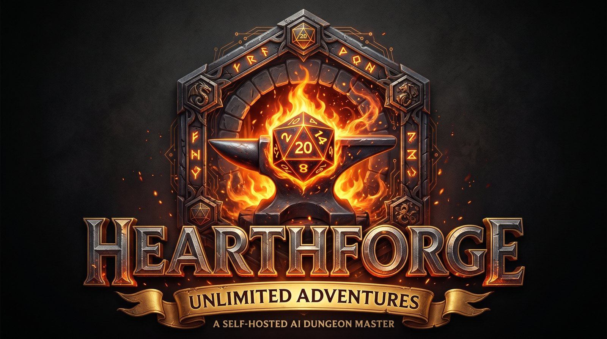
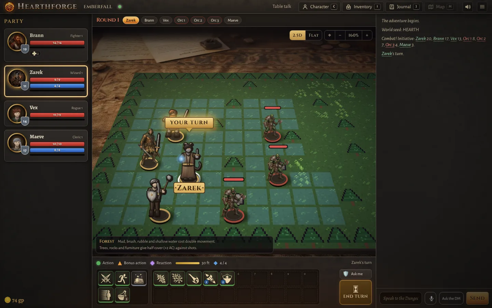
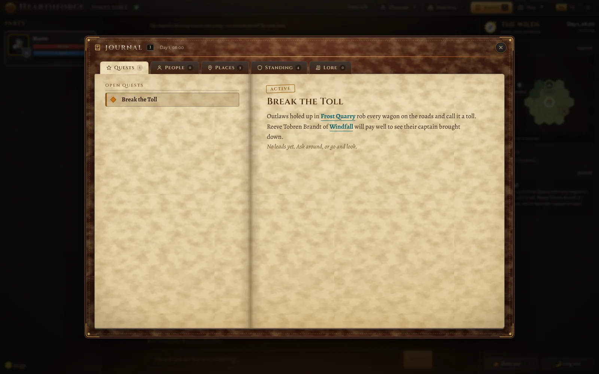
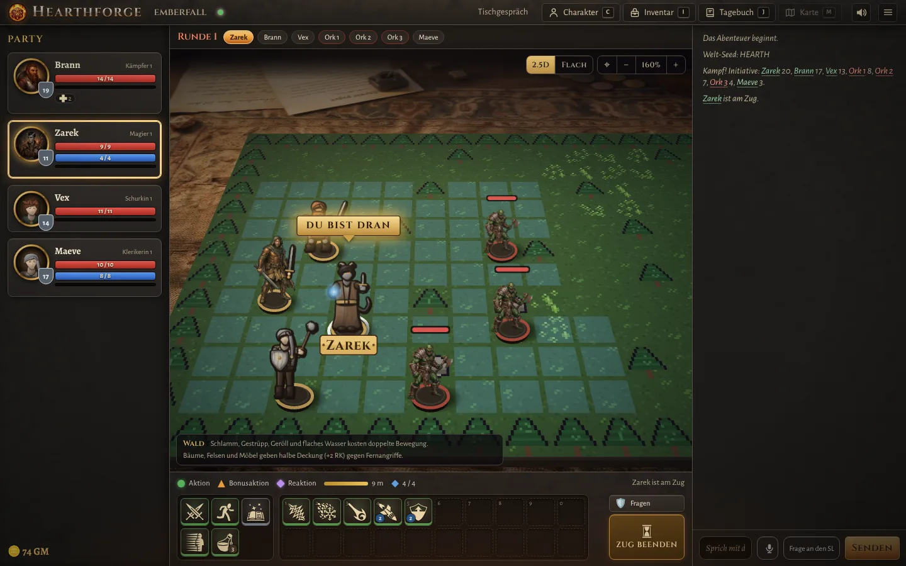

<p align="center">
  
</p>

# Hearthforge

**Dungeons & Dragons 5e at your own hearth, with an AI Dungeon Master.** You run Hearthforge as one Docker container on your own server, and you and your friends play in a browser: alone with up to four heroes, or together at a table of up to four players.

It is built to feel like a pen-and-paper evening, not a video game with a chat window bolted on. The story comes first: you read, you talk, you decide. Claude is the Dungeon Master. It narrates the world, plays everyone you meet and decides what the monsters do. **The server owns the dice, the rules and the game state**, so the Dungeon Master can describe a sword stroke but can never make it land. Players decide what their heroes do, and the Dungeon Master never speaks or acts for a hero.

> **Version 0.9.0 plus a long list of play-test fixes** (see the [changelog](CHANGELOG.md)). Hearthforge is play-tested by its author's own table, in English and Swiss German; some of the newest features have not yet met the live AI Dungeon Master, and the [play-test checklist](docs/PLAYTEST.md) lists them.

<p align="center">
  
</p>
<p align="center"><sub>The story view. Scene cards with a hand-drawn picture at the big moments, framed portraits for the people who speak, and the party, map and quests at your side. (Pictures here are stand-ins made with Google Gemini.)</sub></p>

## What it is like to play

**A story you can read.** Narration arrives as scene cards with a place, a time of day and a mood. Each scene offers a few action buttons, and you can always type anything instead, or speak it. When a named person talks, their painted portrait sits beside their words. At big moments (a boss steps out, a secret comes out, you reach a new place) the Dungeon Master has a charcoal-and-paper picture drawn, which is then sketched stroke by stroke on the page. The Dungeon Master remembers people, places, deeds and quests across the whole adventure, and the journal (`j`) keeps them as a book.

**An open world, then a fight.** You travel a hex overworld and zone maps freely, and a tactical grid appears only when a fight breaks out. Battles run on a map built for where you stand (forest, road, tavern, cave, dungeon and more), in a tilted 2.5D view or a flat one, with painted figures for heroes and monsters and a weapon overlay that shows what each hero actually wields.

<p align="center">
  
</p>

**Heroes you build or borrow.** Sixteen premade heroes, or a guided creator with all twelve SRD classes, nine species, backgrounds, skills, talents and gear. Levels 1 to 20, subclasses, feats, and every class feature running on its own counter. Paper-doll inventory, merchants in every town, magic items and the full SRD spell list.

<table>
  <tr>
    <td></td>
    <td></td>
  </tr>
  <tr>
    <td align="center"><sub>Inventory with paper-doll</sub></td>
    <td align="center"><sub>Character sheet</sub></td>
  </tr>
  <tr>
    <td></td>
    <td></td>
  </tr>
  <tr>
    <td align="center"><sub>Journal: the people you have met</sub></td>
    <td align="center"><sub>Table room: heroes, adventure, invite link</sub></td>
  </tr>
  <tr>
    <td></td>
    <td></td>
  </tr>
  <tr>
    <td align="center"><sub>Lobby: tables, seats and who is here</sub></td>
    <td align="center"><sub>German interface (the story language is a table setting)</sub></td>
  </tr>
</table>

## What is in it

- **An AI Dungeon Master that picks its model by the moment.** A small, fast Claude model for background work, a mid-sized one for everyday narration and monster turns, and the strongest for key moments such as the opening, a first arrival, bosses and level-ups. All three are configurable. The Dungeon Master proposes monster actions through tool calls and the engine rolls the dice. Prompt caching and per-player credit keep the bill visible and low. Without an API key a scripted fallback runs travel, fights and rests, but it cannot improvise.
- **Rules from the 5e SRD 5.2.1.** All 339 spells, all 341 monsters (Challenge 0 to 30, with multiattack, breath weapons, conditions, legendary actions), all 239 magic items, initiative, reactions, concentration, death saves, cover, two-weapon fighting, companions. [Rules and house rules](docs/PLAYING.md#rules-and-house-rules) lists where it simplifies.
- **People with character.** Every named person and companion gets a voice, a quirk and a want. Companions join the party, travel with you and fight by stance; the server plays their turns. Heroic Inspiration is awarded for playing a hero's flaws.
- **Pictures, optional and capped by money.** Painted hero portraits, portraits of the people you meet, painted battle figures and charcoal scene pictures, made with Google Gemini, FLUX (fal.ai or Replicate) or OpenAI on your own account. Nothing is hosted or mirrored, and a monthly budget plus per-player credit decide when pictures pause.
- **Voice.** Speak your actions (your browser does the speech recognition, so the server needs nothing) and hear the story read aloud by a free local voice (Piper) or by ElevenLabs.
- **Together or alone.** Accounts with an owner role, invite links, tables with a host, ready check, invite codes, table talk and whispers, and an in-character vs out-of-character split. Solo tables are private.
- **Campaign books.** Hand the Dungeon Master a published adventure (PDF, text or Markdown) and it runs the book, reading the section the party is in.
- **English and German**, per player. The table picks the story language. German follows the official SRD terms, with Swiss spelling.
- **The Innkeeper**, the owner's panel in the browser: updates, settings, accounts, costs, assets, backups and logs without a terminal.
- **Local first.** One container, SQLite saves that survive updates, fonts bundled, nothing loaded from the internet by the browser.

## Install on Proxmox

On the Proxmox host, as root:

```bash
bash -c "$(curl -fsSL https://raw.githubusercontent.com/DBCooperX/hearthforge/main/scripts/proxmox-install.sh)"
```

The script creates an unprivileged Debian 12 LXC named `hearthforge` (nesting and keyctl on, for Docker), installs Docker, clones this repository to `/opt/hearthforge`, asks for your Anthropic API key, writes `.env` and starts the containers. At the end it prints the address to open and the first password for the [Innkeeper](docs/INNKEEPER.md). From then on you should not need a terminal: updates, restarts, the API key and every setting live in the Innkeeper.

Run the same command again to update an older install, or whenever you prefer the terminal. Defaults are 2 cores, 2 GB RAM, 8 GB disk, DHCP on `vmbr0`, the next free container id and your `local-lvm` or `local-zfs` storage. Override them with variables:

```bash
CTID=120 STORAGE=tank MEMORY=4096 IP=192.168.1.50/24 GATEWAY=192.168.1.1 \
  bash -c "$(curl -fsSL https://raw.githubusercontent.com/DBCooperX/hearthforge/main/scripts/proxmox-install.sh)"
```

| Variable | Default | |
| --- | --- | --- |
| `CTID` | next free id | Container id |
| `HOSTNAME_CT` | `hearthforge` | Container name, also how a re-run finds it |
| `STORAGE` | auto | Storage for the root disk |
| `TEMPLATE_STORAGE` | `local` | Storage holding container templates |
| `BRIDGE`, `IP`, `GATEWAY` | `vmbr0`, `dhcp`, none | Networking |
| `CORES`, `MEMORY`, `SWAP`, `DISK` | `2`, `2048`, `512`, `8` | Resources (MB and GB) |
| `PORT` | `3000` | Port Hearthforge is published on |
| `ANTHROPIC_API_KEY` | prompt | Set it to skip the prompt |
| `HTTPS` | prompt | `local` (a certificate from Caddy's own authority, the default), a domain name for Let's Encrypt, or `off` |
| `BRANCH` | `main` | Git branch to install |

Read [`scripts/proxmox-install.sh`](scripts/proxmox-install.sh) first if you like; it is short.

### Anywhere else with Docker

Any Debian 12 or Ubuntu machine with Docker works (an LXC needs nesting and keyctl; a VM needs nothing special):

```bash
git clone https://github.com/DBCooperX/hearthforge.git /opt/hearthforge
cd /opt/hearthforge
cp .env.example .env     # add your ANTHROPIC_API_KEY, or add it later in the Innkeeper
docker compose up -d --build
```

Open `http://<address>:3000` and sign in as `innkeeper` with the first password the server writes to its log (`docker compose logs`) and to `/data/innkeeper-first-password.txt`. Friends use the same address and sign in with accounts or invite links that the Innkeeper makes. Saved games live in the `hearthforge-data` Docker volume and are kept across updates.

### Updating

Open the Innkeeper, go to **Server** and press **Update now**, or switch on automatic updates. By hand, re-run the installer or run `git pull && docker compose up -d --build` in `/opt/hearthforge`.

### Safety

Hearthforge is built for a home network. Keep it on your LAN, behind a VPN or behind an authenticating reverse proxy, and switch on [HTTPS](docs/PICTURES-AND-VOICE.md#https) (also needed for the microphone). Passwords are stored as scrypt hashes, and five wrong passwords lock an address out for five minutes.

## Where to go next

| | |
| --- | --- |
| [Playing Hearthforge](docs/PLAYING.md) | Tables, turns and reactions, how an adventure starts, campaign books, controls, rules and house rules |
| [The Innkeeper](docs/INNKEEPER.md) | Accounts, tables, costs and credits, updates, backups, resetting a password |
| [Configuration](docs/CONFIGURATION.md) | Every setting and `.env` variable, with defaults |
| [Story pictures, voice and HTTPS](docs/PICTURES-AND-VOICE.md) | Setting up pictures, the narrator, speech input and certificates |
| [Art and music](docs/ART-AND-MUSIC.md) | What downloads by itself, what you add, and the licences |
| [German terms](docs/GERMAN.md) | The glossary behind the German interface |
| [Development](docs/DEVELOPMENT.md) | Running from source, tests, code layout |
| [Changelog](CHANGELOG.md) · [Play-test checklist](docs/PLAYTEST.md) | What changed and what still needs real play |

## Credits and licenses

See [CREDITS.md](CREDITS.md) for the full list. In short: the rules content is from the D&D System Reference Document (CC BY 4.0), the pixel art is original and generated in code (CC0), music and icon packs are fetched at runtime and credited in the game, and the fonts are under the SIL Open Font License. Hearthforge bundles and hosts no third-party art or audio.

This work includes material from the System Reference Document 5.1 and 5.2.1 by Wizards of the Coast LLC, licensed under [CC BY 4.0](https://creativecommons.org/licenses/by/4.0/legalcode). Hearthforge is not affiliated with, endorsed, sponsored, or specifically approved by Wizards of the Coast LLC.
